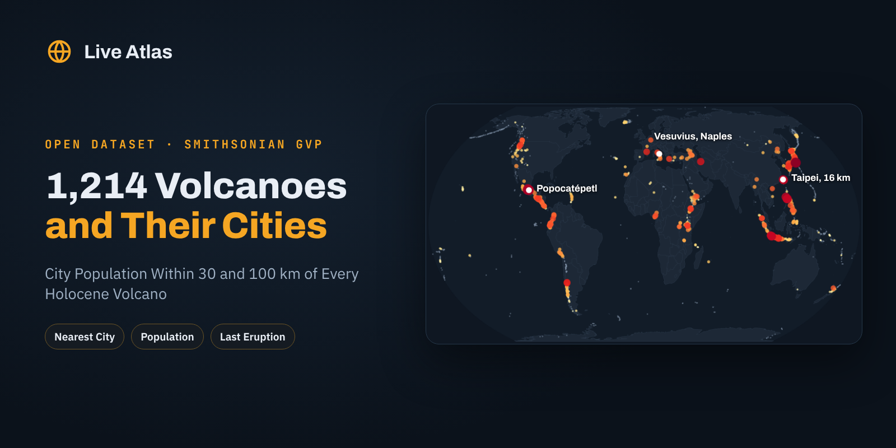

# Volcanoes Near Cities



**English first, version française plus bas, resumen en español al final.**

## Which Volcanoes Have the Most People Living Around Them

More than **11 million people** live in cities within 30 km of the Tatun Volcanic Group, the quiet volcanic field on the northern edge of Taipei. Around Mount Fuji and Hakone, cities within 100 km add up to more than 42 million people. This dataset puts those numbers next to every one of the **1,214 volcanoes** active in the last 11,700 years.

Each row gives the volcano's type, tectonic setting, rock, elevation, last eruption, number of eruptions on record and since 1900, highest explosivity, nearest city, and the population of cities of 20,000 people or more within 30 and 100 km. Every volcano links to its page and eruption timeline on [Live Atlas](https://www.liveatlas.earth/).

### The Headline Numbers

|  |  |
|---|---|
| Holocene volcanoes | 1,214 |
| With a city of 20,000+ within 100 km | 588 |
| With such a city within 30 km | 221 |
| With over 1 million city dwellers within 100 km | 231 |
| Most people within 30 km | Tatun Volcanic Group, Taipei, 11.3 million |
| Then | Colli Albani, Rome, 3.3 million, and Vesuvius, Naples, 2.5 million |
| Most volcanoes | United States 165, Japan 105, Indonesia 101, Russia 95 |

The ranking is not about the most dangerous volcanoes, it is about the most exposed places. Mexico City sits within 100 km of five volcanoes on the list, from Popocatépetl, which has been erupting on and off since 1994, to Iztaccíhuatl and Nevado de Toluca, quiet for thousands of years. Combine `city_population_within_30km` with `eruptions_since_1900` to find the volcanoes that are both active and crowded.

### Files

| file | content |
|---|---|
| `data/volcanoes_near_cities.csv` | 1,214 rows, ranked by city population within 100 km |
| `images/cover.png` | Cover image, 1600 × 800 |

### Columns

**volcanoes_near_cities.csv**

| column | description |
|---|---|
| `rank_by_population_100km` | Rank by city population within 100 km |
| `gvp_volcano_number` | Smithsonian volcano number |
| `volcano` | Volcano name |
| `country` | Country |
| `region` | GVP region |
| `subregion` | GVP subregion |
| `latitude` | Summit latitude |
| `longitude` | Summit longitude |
| `elevation_m` | Summit elevation, m |
| `volcano_type` | Primary volcano type |
| `tectonic_setting` | Tectonic setting and crust |
| `dominant_rock_type` | Major rock type |
| `activity_evidence` | Evidence of Holocene activity |
| `last_eruption_year` | Year of the last known eruption, negative for BCE |
| `eruptions_on_record` | Confirmed and uncertain eruptions in the GVP list |
| `eruptions_since_1900` | Eruptions that started in 1900 or later |
| `max_vei_on_record` | Highest Volcanic Explosivity Index on record |
| `cities_20k_within_100km` | Number of cities of 20,000+ within 100 km |
| `nearest_city` | Nearest city of 20,000+ |
| `nearest_city_km` | Distance to it, km |
| `city_population_within_30km` | Population of those cities within 30 km |
| `city_population_within_100km` | Population of those cities within 100 km |
| `nearby_cities` | Up to five nearest cities with distance |
| `liveatlas_url` | Volcano page on Live Atlas |

### Load It

```python
import pandas as pd

df = pd.read_csv("https://raw.githubusercontent.com/liveatlasearth/volcanoes-near-cities/main/data/volcanoes_near_cities.csv")
df[df.eruptions_since_1900 > 0].sort_values("city_population_within_30km", ascending=False).head(10)[["volcano", "country", "nearest_city", "city_population_within_30km", "eruptions_since_1900"]]
```

### How It Was Built

Volcano and eruption lists were downloaded from the Smithsonian Global Volcanism Program web services on 30 October 2026 (Holocene volcanoes and Holocene eruptions, discredited eruptions left out). Cities come from Natural Earth populated places (1:10m), using `pop_max` for places of 20,000 people or more, with great circle distances from the summit.

### Checked Against The Source

The list matches the 1,214 volcanoes used on Live Atlas with no coordinate difference, and the city populations match the site's own computation for every volcano.

### Read With Care

- **City population, not total population.** Only listed cities count, so rural people are missing and the figures are a minimum. For a full count use a population grid such as GHSL or WorldPop.
- **Metropolitan totals.** Natural Earth `pop_max` gives the urban area, so a single large city can carry the whole ranking.
- **Exposure is not risk.** Wind, terrain and the style of eruption decide who is really threatened.

### License And Citation

**[CC BY 4.0](https://creativecommons.org/licenses/by/4.0/)**. Use it, share it and adapt it, commercially or not, and credit **Live Atlas** with a link to **[liveatlas.earth](https://www.liveatlas.earth/)**, along with the original source below.

```bibtex
@misc{liveatlas_volcanoes_near_cities_2026,
  title  = {Volcanoes Near Cities},
  author = {Ridge, Nathan and {Live Atlas}},
  year   = {2026},
  url    = {https://github.com/liveatlasearth/volcanoes-near-cities},
  note   = {Dataset, version 1.0, built from Smithsonian GVP data}
}
```

Sources. Global Volcanism Program (2024), Volcanoes of the World (v. 5.2.x), Smithsonian Institution, doi:10.5479/si.GVP.VOTW5-2024.5.2. Natural Earth populated places (public domain).

Companion datasets, **[Most Active Volcanoes Since 1900](https://github.com/liveatlasearth/most-active-volcanoes-since-1900)** ([Kaggle](https://www.kaggle.com/datasets/liveatlasearth/most-active-volcanoes-since-1900), [Hugging Face](https://huggingface.co/datasets/liveatlasearth/most-active-volcanoes-since-1900)), **[Tectonic Plates And Major Faults](https://github.com/liveatlasearth/tectonic-plates-and-faults)** ([Kaggle](https://www.kaggle.com/datasets/liveatlasearth/tectonic-plates-and-faults), [Hugging Face](https://huggingface.co/datasets/liveatlasearth/tectonic-plates-and-faults)), **[Significant Earthquakes Since 1900](https://github.com/liveatlasearth/significant-earthquakes-since-1900)** ([Kaggle](https://www.kaggle.com/datasets/liveatlasearth/significant-earthquakes-since-1900), [Hugging Face](https://huggingface.co/datasets/liveatlasearth/significant-earthquakes-since-1900)).

Also on **[Kaggle](https://www.kaggle.com/datasets/liveatlasearth/volcanoes-near-cities)**, with a starter notebook, and on **[Hugging Face](https://huggingface.co/datasets/liveatlasearth/volcanoes-near-cities)**, ready for the `datasets` library.

See every erupting volcano on a live map on **[Live Atlas](https://www.liveatlas.earth/volcanoes-erupting-now/)**.

---

## Version Française

### Les Volcans Les Plus Proches Des Villes

Plus de **11 millions de personnes** vivent dans des villes à moins de 30 km du groupe volcanique de Tatun, au nord de Taipei. Ce jeu de données donne pour chacun des **1 214 volcans** actifs depuis 11 700 ans son type, son contexte tectonique, sa dernière éruption, son nombre d'éruptions, sa ville la plus proche et la population des villes de plus de 20 000 habitants à moins de 30 et de 100 km.

- Le Vésuve a 2,5 millions de citadins à moins de 30 km, avec Naples.
- Autour du Fuji et de Hakone, les villes à moins de 100 km comptent plus de 42 millions d'habitants.
- Ces totaux ne comptent que les villes de la liste, ce sont des minimums.

Licence CC BY 4.0, en citant **Live Atlas** avec un lien vers **[liveatlas.earth](https://www.liveatlas.earth/)** et la source d'origine.

### 🇪🇸 Resumen

1.214 volcanes del Holoceno con su tipo, su última erupción y la población de las ciudades a menos de 30 y 100 km, a partir del Smithsonian GVP y Natural Earth. Popocatépetl y la Ciudad de México incluidos. Licencia CC BY 4.0.

---

**Part of [Natural Hazards Datasets](https://github.com/liveatlasearth/natural-hazards-datasets)**, open data on earthquakes, volcanoes, storms, fires and space weather. Data by [Live Atlas](https://www.liveatlas.earth/), the free live map of the planet's hazards.
